<div align="center">

# fallout.nav

**A 2001 black‑and‑white reversing monitor, a Raspberry Pi CM4 and a wasteland navigator for a camper van.**

[](LICENSE)
[](#hardware)
[](#try-it-without-hardware)
[](web/)
[](https://ptrs.ltd/apps/fallout.nav/)

**[Live demo & project page](https://ptrs.ltd/apps/fallout.nav/)** · [Screenshots](#screenshots) · [Hardware](#hardware) · [Try it on a PC](#try-it-without-hardware) · [Docs](#documentation)

<a href="https://ptrs.ltd/apps/fallout.nav/">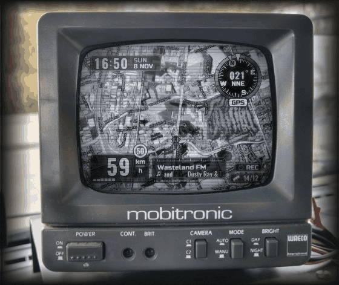</a>

<sub>The real display code running in the browser demo: a heading‑up satellite map swinging through a corner, the Pip‑Boy‑style HUD, the radio panel. On the device the same page feeds a 5″ CRT through a single wire.</sub>

</div>

## What it does

fallout.nav turns a Raspberry Pi Compute Module 4 behind the dashboard of a 2001 Peugeot Boxer camper into:

- **A two‑camera dashcam** that survives a yanked power cable — crash‑safe MPEG‑TS, at most 2 s lost.
- **A moving satellite map** with a Fallout / Mad Max HUD, drawn on a **2001 WAECO RV‑50 CRT** fed straight from
  the CM4's composite DAC (one wire on pin 111, no converter).
- **A van alarm** — knocks, tilt, movement, a camera going dark, people at the van (a neural network on both
  cameras) → hazard lights, siren, protected recordings and a **push notification** with a snapshot.
- **Self‑tuning sensors** — GPS at 10 Hz, a compass that calibrates itself against the GPS course while you drive,
  a gyro for the heading through turns and for spotting reverse gear (the rear camera comes up on its own).
- **A level for the campsite**, **internet radio** on a Bluetooth speaker with a macro‑pad "car radio", and a
  **games menu** for when you're parked.
- **A web control room** for the phone or laptop, in the van or from anywhere through your own server: live
  video, recordings, the alarm, a log of every place the van has stopped, read‑only guest links.

<details>
<summary><b>Full feature list</b></summary>

- **Two‑camera dashcam** — front: OV5647, full 2592×1944 sensor (widest field of view) → hardware H.264
  1440×1080 @ 15 fps; rear: a Wi‑Fi IP camera (Kruger&Matz Connect C150) over RTSP, 2560×1440 H.264 recorded as is,
  with its microphone. Loop recording in 10‑minute MPEG‑TS segments with `fsync` every second: a power cut loses
  ≤ 2 s of video. 10 GB loop by default; protected clips are never deleted; a GPS track next to every segment
  (map, GPX); seeking anywhere through HLS byte ranges; a hard knock while driving protects both cameras' clips.
  Reverse gear switches the car screen to the rear camera (mirrored, `REAR` tag, `NO SIGNAL` instead of a frozen frame).
- **Navigation screen in a Fallout / Mad Max style** on a 5″ monochrome CRT (WAECO Mobitronic RV‑50):
  Esri satellite imagery with streets, heading‑up rotation (the vehicle icon turns first, the map catches up),
  zoom by speed, the camera view when stopped, dead reckoning in tunnels, three compass designs, a wasteland
  muscle‑car icon, a clock, weather, a speed‑limit sign, a radio panel, an almost black standby screen while the
  alarm is armed, a slow pixel drift against burn‑in.
- **Sensors** — Holybro M8N GPS (u‑blox NEO‑M8N, 10 Hz, configured over UBX, Static Hold), IST8310 compass
  with **automatic calibration against the GPS course while driving**, and an MPU‑6050 accelerometer + gyro
  (200 Hz): heading fusion GPS ↔ compass ↔ gyro, compass tilt compensation, reverse detection. GPS time keeps the
  clock right without an RTC (gpsd + chrony).
- **Van alarm** — knocks (MPU‑6050, threshold set on a live vibration meter), tilt, the van moving (GPS), a camera
  that stops sending video, and **camera watch**: NanoDet‑Plus through NCNN on both cameras (a person approaching,
  a face at the windscreen, someone lingering; only people raise the alarm). Answers with the hazard lights (an RC
  relay switch across the hazard button, hardware PWM on GPIO19), a siren on the Bluetooth speaker, protected
  recordings of both cameras, and a **Web Push** to Android / iPhone with a snapshot from 5 s before the event.
- **Level** — parked, the car screen shows pitch, roll and how many centimetres to raise each wheel.
- **Web UI** (phone or laptop, installable as an app) — dashboard, alarm, live video from both cameras (WebRTC, or
  an on‑demand H.264 stream with the rear camera's sound), recordings with alarm events on the timeline,
  navigation/compass/level/GPS/radio/controls/system settings, and a **1:1 physical‑size preview** of the car screen.
- **Composite video straight from the SoC** — a wire on CM4 pin 111 (`VDAC_COMP`), NTSC 480i/60 Hz with output
  margins and mirroring tuned for the RV‑50. The video output can be switched off from the macro pad so it does not
  bleed into the monitor's other camera input; the button on the GPS module switches the car screen between the
  front and the rear camera.
- **Remote access over the internet** — the device keeps an outgoing ssh tunnel to your own server (it sits behind
  a phone hotspot), so the same web UI opens at `https://<server>/fnadmin/`; live video there is a low‑bitrate
  H.264 stream that is only encoded while someone watches.
- **Internet radio on a Bluetooth speaker** — stations from the radio-browser.info directory by mood, genre and era
  (or by name), played by mpv through BlueZ + bluez-alsa (A2DP) on the CM4's on-board Bluetooth; the speaker is
  paired from the web UI and reconnects by itself; the station resumes after a reboot. The car screen shows a
  tuner panel with the station and the scrolling track title. A 6-key macro pad with a knob switches stations
  (in order, at random or through the favorites; holding the mode key saves the station to favorites) and the volume.
- **Position log (Tracking)** — a GPS point every minute, queued on the device while offline, merged on the server
  into places and visits (the same spot within 50 m is not recorded twice); a hybrid Esri map with parking and
  transit points, the visit history of each place, and the live vehicle position.
- **Games while parked** — a gamepad opens a games menu on the car screen: RetroArch (Freedoom through PrBoom,
  Game Boy homebrew through Gambatte) and EDuke32 with the Duke Nukem 3D shareware episode.
- **Weather** — [Open-Meteo](https://open-meteo.com/) for the GPS position, now + the next two days in place of the
  radio panel, wind streaks around the vehicle; every 30 min or after 25 km, cached for offline use.
- **Speed‑limit sign** next to the speedometer from offline OpenStreetMap roads: `tools/speedlimits.sh` builds the
  database from a Geofabrik extract (Poland by default, implicit limits such as `PL:urban`) and copies it to the
  device; `fnav/core/speedlimit.py` matches the GPS position and course to the road once a second.

</details>

## Screenshots

<table>
<tr>
<td width="33%"><a href="site/assets/gallery/v1.webp">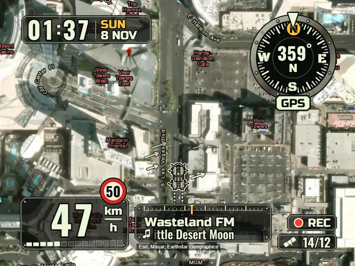</a><br><sub><b>Riveted dial</b> — clock, speed limit, radio</sub></td>
<td width="33%"><a href="site/assets/gallery/v3.webp">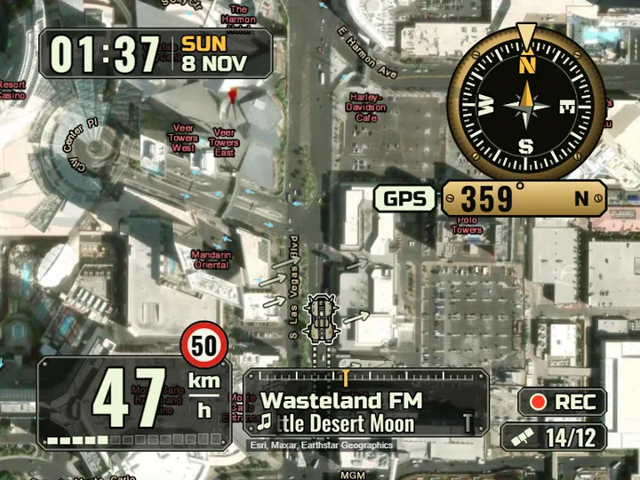</a><br><sub><b>Brass compass</b> — one of three compass designs</sub></td>
<td width="33%"><a href="site/assets/gallery/hud-rear.webp">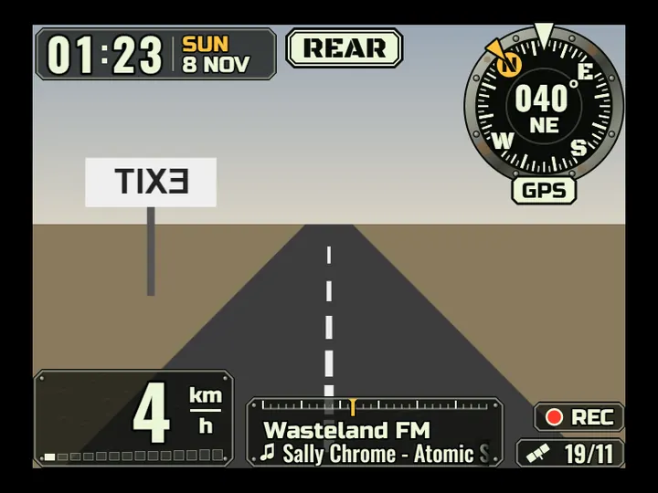</a><br><sub><b>Rear view</b> — comes up in reverse, mirrored</sub></td>
</tr>
<tr>
<td><a href="site/assets/gallery/hud-impact.webp">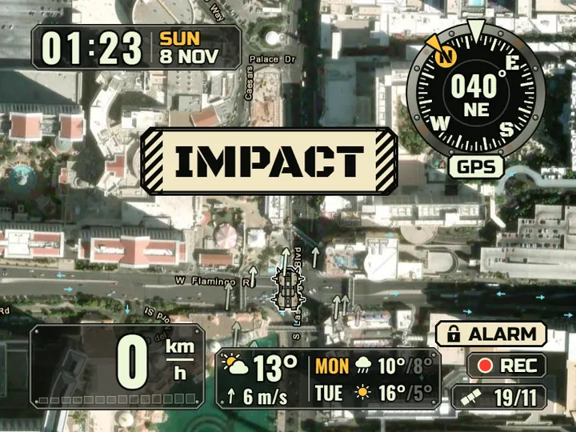</a><br><sub><b>Alarm</b> — an impact while armed, weather panel</sub></td>
<td><a href="site/assets/gallery/hud-level.webp">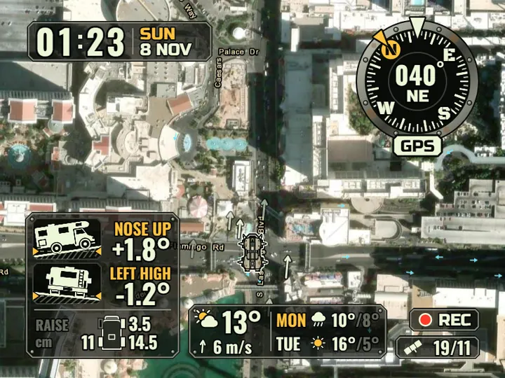</a><br><sub><b>Level</b> — how far to raise each wheel</sub></td>
<td><a href="site/assets/gallery/ntsc-final.webp">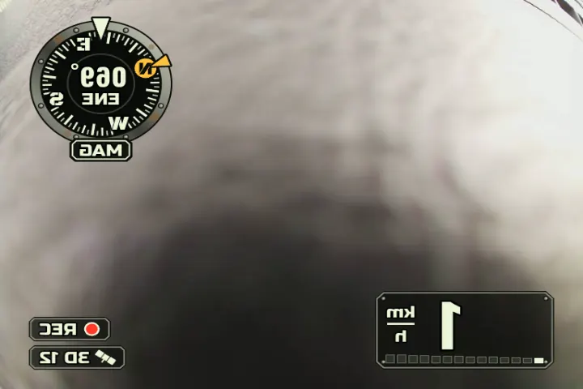</a><br><sub><b>On the wire</b> — NTSC 480i, mirrored for the RV‑50</sub></td>
</tr>
<tr>
<td colspan="3" align="center"><a href="site/assets/gallery/web-phones.webp">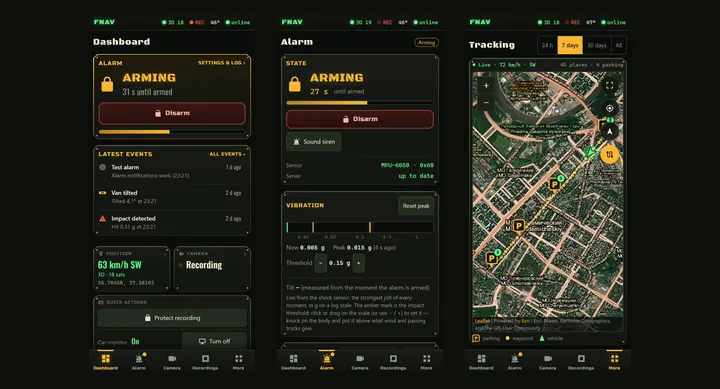</a><br><sub><b>The web app on a phone</b> — dashboard, alarm, tracking (mock data)</sub></td>
</tr>
<tr>
<td><a href="site/assets/gallery/web-dashboard.webp">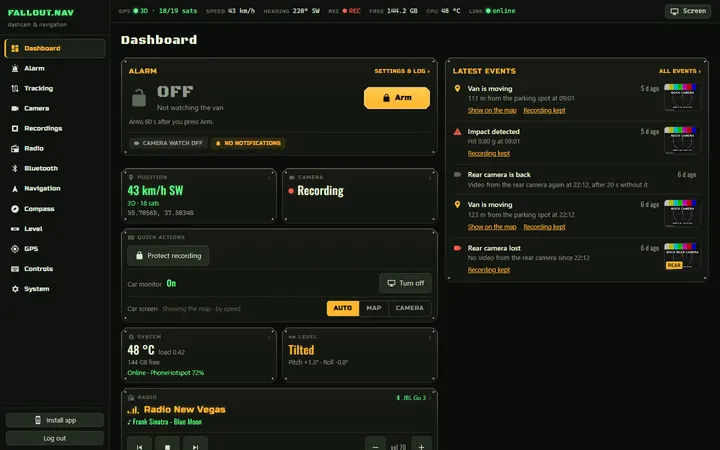</a><br><sub><b>Dashboard</b> — the alarm, latest events, the van at a glance</sub></td>
<td><a href="site/assets/gallery/web-alarm.webp">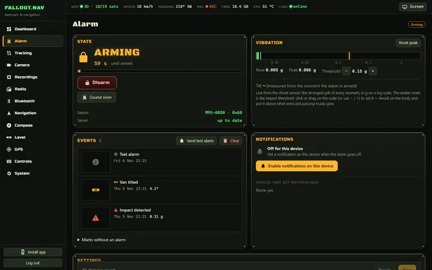</a><br><sub><b>Alarm</b> — live vibration meter, events, push</sub></td>
<td><a href="site/assets/gallery/web-tracking.webp">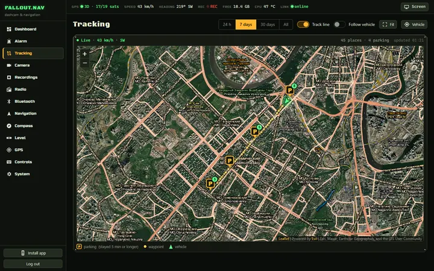</a><br><sub><b>Tracking</b> — places, visits, the live position</sub></td>
</tr>
</table>

More on the [project page](https://ptrs.ltd/apps/fallout.nav/#gallery), including the wiring diagrams and the
stories behind the hard parts.

## Hardware

| Part | Notes |
|---|---|
| Raspberry Pi CM4 (eMMC, Wi‑Fi, 4 GB) on Waveshare **CM4‑NANO‑B** | Raspberry Pi OS (Debian 13 trixie) |
| OV5647 camera | CSI0, `dtoverlay=ov5647,cam0` |
| Holybro M8N GPS + IST8310 compass (10‑pin JST‑GH) | UART5 `/dev/gps0` + I2C‑1 |
| Kruger&Matz Connect C150 (rear) | Wi‑Fi IP camera, RTSP; found again by its MAC when its address changes |
| MPU‑6050 (GY‑521) | I2C‑3 (`dtoverlay=i2c3,pins_4_5`): VCC → pin 17, GND → 9, SDA → 7 (GPIO4), SCL → 29 (GPIO5) |
| RC relay switch across the hazard button | S → pin 35 (GPIO19, PWM1), + → 4 (5 V), − → 39 (GND) |
| 6‑key USB macro pad with a knob (1189:8890), gamepad | programmed as F13–F21 + Enter; keys in `settings.keypad` |
| Bluetooth speaker | on‑board Bluetooth, A2DP through bluez‑alsa |
| WAECO Mobitronic RV‑50 monitor | composite input, B/W CRT |
| DC‑DC 12 → 5 V, 3 A | one shared ground for the Pi and the monitor |

<details>
<summary><b>GPS module → 40‑pin header</b></summary>

| GH pin | Signal | → | 40‑pin | Pi signal |
|---|---|---|---|---|
| 1 | VCC 5V | → | 2 | 5V |
| 2 | RX (GPS input) | → | 32 | GPIO12 TXD5 |
| 3 | TX (GPS output) | → | 33 | GPIO13 RXD5 |
| 4 | SCL | → | 5 | GPIO3 SCL |
| 5 | SDA | → | 3 | GPIO2 SDA |
| 6 | SAFETY_SWITCH | → | 16 | GPIO23 — short press: front/rear camera on the car screen, long press: protect recording |
| 7 | SAFETY_SWITCH_LED | → | 18 | GPIO24 — blinks while recording |
| 8 | VDD_3V3 | → | 1 | 3.3V |
| 10 | GND | → | 6 | GND |

The GPS uses the PL011 UART5 (`dtoverlay=uart5`) so that the primary UART0 stays with the on‑board Bluetooth,
which plays the internet radio on a Bluetooth speaker.

</details>

**Composite video:** CM4 connector J2, **pin 111 `VDAC_COMP`** (inner/odd row, 6th from the pin‑101 end; its
neighbours are 109 `PCIe_nRST` and 113 GND — "ground immediately on the far side" is the reliable check) → video
pin of the monitor input, GND → its ground. See [`docs/device-report.md`](docs/device-report.md) and the
[wiring diagrams](https://ptrs.ltd/apps/fallout.nav/#hardware).

## How it works

Every job is its own systemd service, so a crash in one never stops the dashcam:

| Service | What it does |
|---|---|
| `fnav-camera`, `fnav-camera-rear` | Picamera2 / RTSP (PyAV) → crash‑safe MPEG‑TS recorder, MediaMTX (WebRTC), small frames for the screen and for vision |
| `fnav-watch` | alarm vision: NanoDet‑Plus (NCNN) people and YuNet faces on frames from shared memory |
| `fnav-core` | FastAPI backend: settings, 10 Hz WebSocket telemetry, heading fusion, alarm, recordings loop, tile cache, radio, Bluetooth, level, games (port 80; 127.0.0.1:8090 for the tunnel) |
| `fnav-display` | the car screen: a web page in a cage + Chromium kiosk, out through composite |
| `fnav-radio`, `fnav-games` | mpv → bluez‑alsa; RetroArch / EDuke32 on demand |
| `fnav-tunnel` | outgoing ssh tunnel to your server (`server/fnav-relay`: position log, push, login while the van is offline) |
| `gpsd`, `chrony`, `mediamtx`, `bluetooth` + `bluealsa` | system services |

```
fnav/core     FastAPI backend: auth, settings, telemetry, nav logic, alarm, Esri tile cache, recordings, radio, system
fnav/camera   Picamera2 / RTSP pipelines, crash-safe MPEG-TS recorder, RTSP to MediaMTX (WebRTC), MJPEG for the screen
fnav/sensors  gpsd client, UBX configuration, IST8310 and MPU-6050 drivers, GPS auto-calibration, heading fusion, GPIO
fnav/watch    alarm vision on frames from shared memory
web/display   the car screen (Canvas renderer for Esri tiles + Pip-Boy HUD), also runs as an in-browser demo (?demo=1)
web/admin     the web app (vanilla ES modules, no build step)
pi/           install.sh, deploy.sh, systemd units, boot config, MediaMTX, sudoers/polkit
server/       fnav-relay (stdlib Python) and the nginx snippet
tools/        remote.sh (server + tunnel setup), publish_site.sh, speedlimits.sh, UBX/I2C helpers
site/         the project page
```

## Try it without hardware

The car screen's browser demo needs nothing but a static web server:

```bash
python -m http.server 8130
# http://127.0.0.1:8130/web/display/index.html?demo=1&camera=../../site/assets/camera-demo.jpg
```

The backend and the web app run on a PC against mock sensors:

```bash
pip install -e .[dev]
python -m fnav.core --mock --port 8000          # http://127.0.0.1:8000/admin/   (password: fnav-dev)
python -m fnav.camera --fake                    # synthetic camera + recorder
python web/admin/dev/mockserver.py --port 8300  # UI-only mock with weeks of fake tracking, alarm events, recordings
python -m pytest                                # Python tests
node --test tests/display/*.test.mjs tests/admin/*.test.mjs   # JS tests
```

## Install on the device

```bash
pi/deploy.sh --stage            # from a PC (Git Bash / Linux): upload the repo to the device
ssh <device> 'cd ~/fallout.nav && sudo ./pi/install.sh && sudo reboot'
pi/deploy.sh                    # later updates
```

<details>
<summary><b>Remote access, the position log and push notifications</b></summary>

```
browser ─ https://<server>/fnadmin/ ─ nginx ─┬─ static copy of web/          (opens even when the device is off)
                                             ├─ /api/tracking/, /api/push → fnav-relay  (lives on the server)
                                             └─ /api, /ws       → 127.0.0.1:18080 ─ ssh -R ─ device fnav-core :8090
device: fnav-core ─ a point a minute, alarm events → SQLite outbox ─ ssh -L 127.0.0.1:18095 → fnav-relay
```

Requests through the tunnel arrive at a separate listener with no localhost trust; the password is the same as on
the device (the server checks the same session cookie). One-time setup from a PC, after `pi/deploy.sh`:

```bash
cp tools/remote.env.example tools/.remote.env   # server login, site name, nginx site file
tools/remote.sh setup                           # relay, nginx, tunnel user/key, device config, web copy
tools/remote.sh web                             # after UI changes (pi/deploy.sh and tools/remote.sh deploy do it too)
```

Guest access (System page, "Guest access (read only)"): a link that opens the whole admin for someone else — on the
van's network or through the server — for 1 day, 7 days or until a chosen date. A guest sees everything but the
device refuses every change (403), keys are not shown, and a link can be revoked at once.

</details>

## Documentation

The design notes are written in Russian (the code, UI and this README are in English):

| Document | About |
|---|---|
| [`PLAN.md`](PLAN.md) | the original plan and decisions |
| [`docs/contracts/overview.md`](docs/contracts/overview.md) | processes, ports, zones, rules — start here |
| [`api.md`](docs/contracts/api.md) · [`display.md`](docs/contracts/display.md) · [`camera.md`](docs/contracts/camera.md) | REST/WebSocket API, the car screen, cameras and recordings |
| [`alarm.md`](docs/contracts/alarm.md) · [`vision.md`](docs/contracts/vision.md) · [`level.md`](docs/contracts/level.md) | the alarm, camera watch, the level |
| [`radio.md`](docs/contracts/radio.md) · [`remote.md`](docs/contracts/remote.md) · [`demo.md`](docs/contracts/demo.md) | radio and Bluetooth, remote access, the browser demo |
| [`docs/device-report.md`](docs/device-report.md) · [`pi/README.md`](pi/README.md) | hardware bring‑up notes, the Pi installer |

## How it was built

The first version was designed and written in about a day by Claude acting as lead/integrator with seven parallel
sub‑agents (backend, map renderer, HUD design, web UI, camera/recorder, sensors, system), coordinated through
the written contracts in `docs/contracts/`. The rear camera, the alarm, radio, games, the level and remote access
followed over the next three weeks, driven by whatever broke or was missing in the van. The project page tells
[the story and the hard parts](https://ptrs.ltd/apps/fallout.nav/#hard-parts).

## Status and contributing

This is a one‑off build for one van, not a product: it expects this hardware, and some defaults (the speed‑limit
region, the vehicle size for the level) are ours. Issues and pull requests are welcome, and if you build something
similar on an old screen, open an issue and show it off.

## Credits and license

MIT — see [LICENSE](LICENSE). Third‑party parts keep their own licenses: fonts in `web/display/ui/fonts/`
(SIL OFL 1.1, see `LICENSES.md` there), `web/admin/vendor/mpegts.js` (Apache‑2.0) and
`web/admin/vendor/hls.light.min.js` (hls.js 1.7.3, Apache‑2.0), the detection models in `fnav/watch/models/`
(NanoDet‑Plus, Apache‑2.0; YuNet, MIT).

Map imagery © Esri and its data providers (Esri, Maxar, Earthstar Geographics and the GIS user community).
Weather data by Open-Meteo.com (CC BY 4.0). Speed limits © OpenStreetMap contributors (ODbL). Radio stations from
radio-browser.info.

A fan‑made hobby project, not affiliated with the Fallout or Mad Max franchises, WAECO, Peugeot, Kruger&Matz or
Raspberry Pi Ltd.
